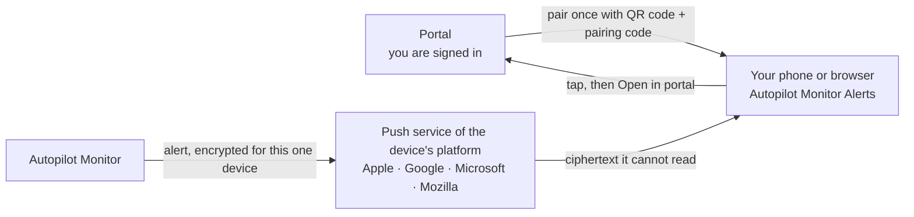

# Push Notifications

Get your enrollment alerts on your phone or in your browser — and a ping when an enrollment you watch with **Notify me when done** finishes. Every push is encrypted end to end for the one device that receives it. You need no app store app and no messenger account.

## How it works

1. **You pair the device once, from the portal.** You are signed in there. The device itself never signs in.
2. **Autopilot Monitor encrypts each alert for that one device** and hands it to the push service of the device's platform.
3. **The push service delivers ciphertext it cannot read.** Only the paired device can decrypt it.
4. **A tap opens the entry on the device.** **Open in portal** takes you to the details, behind your sign-in.

The receiver app is the page `https://portal.autopilotmonitor.com/push/`, named **Autopilot Monitor Alerts** — **AM Alerts** on the iPhone Home Screen.

## Set up



### Add a Push channel

A Tenant Admin opens **Settings → Notifications**, clicks **Add channel** and selects the provider **Push to paired devices**. There is no URL to enter. Pick the triggers as for any other channel — Start, Success, Failure, Hardware rejection, SLA, What's new — and save.

The channel's alerts reach every paired device of your tenant's Admins and Operators. A tenant has one Push channel.


Keep the Push channel's triggers to what everyone needs — Failure and SLA, for example. For a single enrollment, use [Notify me when done](#notify-me-when-done).




### Pair a device

Admins and Operators open **Push devices** under **Settings → Notifications** and click **Pair a device**. The dialog shows a QR code, a pairing code such as `ABCD-EFGH-JKM` and the link `https://portal.autopilotmonitor.com/push/pair/`. The code is valid for 10 minutes and works once.

On the device you want to pair, scan the QR code or open the link. Then:

* **iPhone and iPad:** in Safari, tap **Share** → **Add to Home Screen**, then open **AM Alerts** from the Home Screen. The code from the link is kept for 10 minutes, so pairing continues in the app; otherwise type the code. Tap **Enable notifications** and allow notifications.
* **Android, Windows and macOS:** open the link in the browser, enter the code if needed, click **Enable notifications** and allow notifications when the browser asks. On Android, adding the page to the Home screen is recommended: Android keeps the notification permission for installed apps.

Back on your computer, the dialog shows the device's name and platform: *"‹name› (‹platform›) wants to pair. Confirm only if this is your device."* Click **Confirm**. The device shows **Paired** and receives a **Device paired** notification.



### Send a test

Click **Send test** next to the device under **Push devices**. The device receives a **Test notification**.




**iPhone and iPad:** notifications reach only the app on the Home Screen, never a Safari tab. Open **AM Alerts** from the Home Screen. iOS or iPadOS 16.4 or later is required.


## Notify me when done

Click **Notify me when done** in the header of a running session, then walk away. Your paired devices get a push when the enrollment ends. While the watch runs, the button reads **Watching**.

* **Who sees it:** Admins and Operators, once your tenant has a Push channel. To start a watch, you need a paired device.
* **What it waits for:** the end of the session, or the end of pre-provisioning. On a sealed pre-provisioned session, click again to wait until the user phase ends.
* **What arrives:** *Enrollment finished*, *Pre-provisioning finished* or *Enrollment failed*, with a text such as *CONTOSO-4711 (…8F2K) finished enrollment.*
* **How long it lasts:** 48 hours, or 30 days on a sealed pre-provisioned session. A watch is used up when it fires. Click the button again to stop watching.

## What a push contains

A push shows what fits on a lock screen. The details stay in the portal, behind your sign-in.

| A push carries | A push never carries |
| --- | --- |
| The alert title and a short text: the event and its result | Names or UPNs of end users |
| The device name and the serial number, masked to its last four characters | IP addresses |
| Where relevant: hardware, duration, rule, severity, category, SLA figures | Location |
| Your tenant's name | Free text from telemetry — script output, log lines, comments, failure-reason text |
| A portal link with opaque IDs only | Secrets |

Tapping a notification opens its entry on the device. **Open in portal** opens the portal, where your sign-in applies.

## The history on your device

The receiver app keeps the pushes it received in a history. The history lives on the device only and is never sent back.

* **Retention:** 30 days by default. Change it from 0 to 365 days on the receiver's **Status** page; 0 keeps entries until the cap. The history holds at most 200 entries.
* **Actions:** long-press (or right-click) an entry. **Delete** removes it from this device only; **Open in portal** opens the portal.
* **Unread entries:** the app icon badge counts them. Opening the history marks them read.
* **Pairing on iPhone:** a first-party cookie hands the pairing code from Safari to the Home Screen app. It expires after 10 minutes and carries only the code.

## Security and Conditional Access

### Encrypted end to end

Every push is encrypted end to end between Autopilot Monitor and the paired device, with Web Push message encryption (RFC 8291). The browser creates the device's key pair when you pair it and keeps the private key. Autopilot Monitor stores only what it needs to encrypt for that device.

### What the push services see

The push service of the device's platform — Apple, Google, Microsoft or Mozilla — relays ciphertext it cannot read. It sees delivery metadata: the device's endpoint, the time, the size, the urgency and an opaque topic. Push requests go only to these four push services, over HTTPS. There is no messenger account and no bot token at a third party.

### Conditional Access

The push page on a paired device requires no sign-in. You pair it from your signed-in portal session. From then on it only receives notifications and cannot read portal data — its device token only manages its own pairing.

Because the device never signs in, Conditional Access has nothing to evaluate on it. That is also why push works on phones your policies keep out of the portal. And it is why a push carries only lock-screen details, and a tap leads into the portal behind your sign-in.

### Your Tenant Admins decide

A Tenant Admin decides whether push is used, by adding the Push channel. Under **Push devices**, Tenant Admins see every paired device of the tenant and can remove any of them. Everyone else sees their own devices.

### When a device stops receiving

* **Owner inactive:** a device pauses when its owner has not signed in to the portal for 30 days. Its last notification, **Alerts paused**, says *"Sign in to the portal to resume alerts on this device."* The owner's next portal sign-in resumes it. A paused device is deleted 90 days after its owner's last sign-in.
* **Role lost:** removing, disabling or demoting a member below Operator removes their devices at once. For a role assigned through Entra app roles, this happens when the member's next sign-in no longer carries the role. If the device is online, a final message clears its history.
* **Channel off:** switching the Push channel off stops everything, including Notify me when done. The devices stay paired and listed, so they can be removed. Switching the channel back on resumes delivery.

For security reviewers: [Security & Privacy FAQ](../trust/security-faq.md#are-push-notifications-encrypted) and [Data Flows & External Services](../trust/data-flows.md).

## Supported platforms

| Device | Browser | Good to know |
| --- | --- | --- |
| iPhone and iPad | Safari on iOS or iPadOS 16.4 or later | Add the page to the Home Screen and open it from there |
| Android | Chrome | Recommended: add the page to the Home screen, so Android keeps the notification permission |
| Windows | Chrome, Edge or Firefox | Receives only while the browser is running |
| macOS | Chrome, Edge, Firefox or Safari | Receives only while the browser is running |

## Limits

* **Who:** Admins and Operators — whether their role comes from the member list under **Settings → Access Management** or from Entra app roles. Viewers and the Progress Portal have no push. Delegated (MSP) access does not include push yet: the button does not appear on sessions of tenants you manage. See [Roles & Permissions](../concepts/roles-and-permissions.md#push-notifications).
* **One Push channel per tenant.**
* **Flood control:** a device receives at most 10 pushes in 10 minutes. Then it gets one **Further alerts muted** notification that says until when (*"…muted until HH:mm UTC"*).

## Troubleshooting

| Problem | What to do |
| --- | --- |
| Nothing arrives on an iPhone or iPad | Open **AM Alerts** from the Home Screen — notifications reach only the Home Screen app. iOS or iPadOS 16.4 or later is required. |
| Notifications are blocked | Allow notifications for the app or the site in the system or browser settings, then try again. |
| Notifications are held back | A Focus mode (or Do Not Disturb) can hold them back. Allow **AM Alerts** or your browser in that Focus. |
| Nothing arrives in a managed browser | Your organization's browser policies may block notifications for websites. Ask your admin to allow them for `https://portal.autopilotmonitor.com`. |
| The device shows **Paused** | Its owner has not signed in to the portal for 30 days. Sign in to the portal; delivery resumes. |
| The device shows **Stale** | The push service refused the last delivery, for example after the browser renewed its subscription. Open the receiver app on that device once; it repairs the subscription. |
| You deleted the Home Screen app or cleared the site data | The pairing is gone. Pair the device again and remove the old entry under **Push devices**. |
| A desktop browser misses alerts | Desktop browsers receive pushes only while they are running. |
