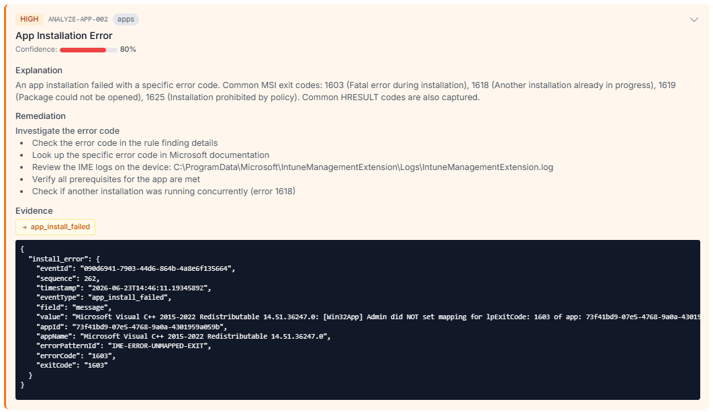

# Session Details & Diagnosis

## Session detail

Opening a session from the dashboard shows everything Autopilot Monitor knows about that enrollment, updating live over SignalR while the enrollment runs. The page is a stack of collapsible sections with a scroll-spy sidebar:

* **Session Info** — status, enrollment duration, enrollment type, ConfigMgr detection (with the [ConfigMgr Watcher](../reference/settings.md) enabled), NTP offset. On a failed enrollment without a diagnostics package, a note says when diagnostics upload isn't set up for the tenant (see [When no rule explains a failure](#when-no-rule-explains-a-failure)). When the platform paused or ended the session's monitoring under a [protective limit](../concepts/protective-limits.md), a card says so: the cause, when it happened and until when, and for the event limit how many events the session sent against which limit.
* **Device Details** — a deep telemetry card: OS build/edition, per-adapter network configuration (Wi-Fi SSID and signal, proxy config, active interface), security posture (Secure Boot, TPM, BitLocker with encryption method), agent and IME versions (with an *outdated* badge when applicable), the full **Autopilot profile** including a clickable OOBE-configuration bitmask decoder, and hardware specs down to DIMMs, disks, battery health, and GPUs.
* **Enrollment Progress** — the phase timeline; click a phase to jump to its events. Pre-provisioning (White Glove) sessions show the technician phase and the user phase separately. While the enrollment runs, a line below the timeline follows the Windows quality update at the end of OOBE: how long it has been running and when it restarts the device, then how long the device has been waiting for its user since the update's restart — or that the update failed or was skipped. When the device has not reported for 15 minutes, the line says when it last did. Below the timeline, finished enrollments carry the [Time attribution](#time-attribution) breakdown.
* **Analysis** — the [analyze rule](../rules/analyze-rules/README.md) findings as severity-colored cards with a confidence bar and fleet context from your tenant's rule telemetry: *"fires on X % of enrollments"* (30 days) and *"fired in N enrollments in the last 14 days"* — so a finding immediately shows whether it is a one-off or something the fleet is hitting. **View sessions** next to the count opens the dashboard filtered to the enrollments where that rule fired. Expanding a card reveals the explanation, remediation steps, related docs, and an **Evidence** block whose links jump to the exact triggering event in the timeline. A value the enrollment never recorded is left out: a list item or remediation step that needs it disappears, and in running text it reads –. **Analyze Now** re-runs all rules on demand (analysis also runs automatically at completion/failure). When no rule flagged a failed session, the section shows how to investigate it with your AI assistant instead — see [When no rule explains a failure](#when-no-rule-explains-a-failure).

<figure><figcaption>
An expanded finding: severity and confidence at the top, the explanation and remediation steps in the middle, and the raw evidence — with a link to the exact triggering event — at the bottom.
</figcaption></figure>

* **Annotations** — your team's own verdict on the session, next to the automated analysis. See [Annotations](#annotations).
* **Performance** — charts from the periodic performance snapshots.
* **Script Executions** — platform and remediation scripts with their output (stdout visibility is a [tenant setting](../reference/settings.md#agent-parameters); stderr is always shown). A script that was still running when the session ended is marked **Incomplete**: the agent stopped observing before its result arrived, so it counts as neither succeeded nor failed. When the agent corrected a platform script's output from the result the Intune Management Extension saved, the output carries the note *from IME's saved result*; if the log had given the run another script's output, the exit code shows as **exit n/a**. The event timeline marks the original entry as corrected.
* **Downloads / Install Progress** — per-app download progress and the full install lifecycle. Rows that do not come from the Intune Management Extension carry a small source pill — **Click-to-Run** for the Microsoft 365 Apps installation (with a live timer) and **RealmJoin** for RealmJoin packages — so a Win32 app and the underlying installer it triggers are visibly two different rows instead of looking like a duplicate (see [Microsoft 365 Apps appears twice](../troubleshooting/microsoft-365-apps-shown-twice.md)). An app that was still installing or downloading when the session ended is marked **Incomplete**: the agent stopped observing before the outcome arrived, so it is neither a success nor a failure, and the time shown (`≥ 29s`) is how long it was watched. In these panels and in Script Executions, a thin **Account Setup** divider marks the first row that started after the Enrollment Status Page entered Account Setup; the rows above it, under **Device Setup**, started before that. The divider says when a row started, not how it is assigned — the management extension runs device-assigned scripts and apps whenever it syncs, so on a Cloud PC they routinely appear under Account Setup. The assignment itself is the **User** pill on an app row (device assignment is the default and carries no pill). Device Preparation (Autopilot v2) sessions have no such split and show no divider.
* **Event Timeline** — the raw, phase-grouped event stream with severity filters (Info/Warning/Error/Critical), expand/collapse controls, and auto-scroll for live sessions. The search box filters the timeline as you type — see [Filtering the event timeline](#filtering-the-event-timeline).

**Header actions:** **Collect Logs** (see below), **Download Diagnostics** (when a diagnostics package was uploaded), **Diagnosis** (every session with something to explain — see [Guided diagnosis](#guided-diagnosis)), **Report Session** (send a report with comment and optional attachments), **Notify me when done** (on a running session: a push to your paired devices when the enrollment ends — see [Push Notifications](../integrations/push-notifications.md#notify-me-when-done)), and — with [Admin Mode](../concepts/roles-and-permissions.md#admin-mode) on an *In Progress*, *Pending* or *Stalled* session — **Succeed** / **Fail** overrides.

## Filtering the event timeline

The search box above the timeline filters the events as you type. It looks at the event type, the message, the source **and the event's details** — the JSON you see when you expand an event. That last part matters for [gather rules](../rules/gather-rules.md): a log-parsing rule puts the matched log line, the extracted values and the rule ID into the details, not into the message, so `"Installation completed"` finds the HP Image Assistant line even though no message contains those words. It follows the conventions you know from other search boxes:

| You type | You get |
| --- | --- |
| `certificate` | Events whose type, message, source or details contain *certificate* |
| `esp apps` | Events matching **both** terms — several terms are combined with AND, each may hit a different field |
| `"Installation completed"` | A quoted phrase is matched as one term — spaces included |
| `-app_install_progress` | Everything **except** the matching events |
| `esp -progress` | A search term and an exclusion combined |
| `"exit code -1"` | A quoted term is taken literally, leading minus included |
| `type=app_install` | Only the event type is searched — the `app_install_*` family, wherever the words appear elsewhere |
| `data=hpia-log-collect` | Only the details are searched — here every event a specific gather rule produced (`content=` is an alias) |
| `-source=ImeLogTracker` | An exclusion pinned to one field: hides IME log events, keeps an event that merely *mentions* the tracker |

Field names for `field=value` (a colon works as well): `type`, `message`, `source`, `data` (or `content`). Anything else stays an ordinary search term, so a time like `14:30` still works. Matching is case-insensitive and by substring, so `-app_install` hides the whole `app_install_*` family in one go, and `-perf -heartbeat` strips out several kinds of noise at once. While an exclusion is active, a **hiding …** pill next to the severity filters names the excluded terms and the counter reports how many events are left.

Two things to know about the details search:

* **Only values are searched, never field names.** `-error` hides events whose text contains *error* — it does not hide every event that merely carries an empty `errorCode` field. Likewise `data=exitcode` finds nothing unless *exitcode* is a value somewhere.
* **You search what you see.** Details that contain JSON as text (a gather rule's console output, for example) are unpacked the same way the expanded view shows them, so a term that is visible there is a term you can search for.

Filtering is a view on the session you already have open: it changes nothing in the data, works alongside the severity filters, applies to both parts of a pre-provisioning session as well as the raw view, and clearing the box brings every event back.

## Device history

If the device behind the session has enrolled before, a banner at the top of the page says so: **"Attempt 3 for this device · 2 previous enrollments recorded"**. It is the answer to *"is this a new problem, or has this machine been fighting us all week?"* — a question the session page alone could never answer.

**View history** expands the device's last 20 finished enrollments, newest first, each with its final status, start time, recorded duration, and a link to open it. Badges mark **Pre-provisioning** and **Device Preparation** enrollments, and **admin-marked** flags a session whose final status an administrator set by hand. The attempt number follows the [device journey](../concepts/sessions-and-statuses.md#device-journeys--attempts) rules — a pre-provisioned device that is later handed to a user is *one* attempt, not two, and a re-deployment months later starts counting at 1 again.

Devices are matched by serial number. Devices without a usable serial number get no banner rather than a wrong one.

## Time attribution

Once an enrollment has finished with a real verdict — *Succeeded* or *Failed* — the phase timeline is followed by a **Time attribution** bar: where the enrollment's minutes actually went, split into **Device preparation**, **Apps (ESP)**, **Windows Update**, **Waiting for sign-in**, **Identity & Hello**, **User ESP**, **Desktop handoff**, and an explicit **Unattributed** remainder. The bar always adds up to the session's recorded enrollment duration — time that could not be assigned to a segment is shown as unattributed instead of being distributed or hidden. For pre-provisioning enrollments, the pause between the technician phase and the user phase is excluded, exactly as it is from the enrollment duration itself.

* **Windows Update** is the quality update Windows installs at the end of OOBE (Enrollment Status Page setting *Install Windows quality updates*): from the start of the update page to the last sign of the update, its download, install and restarts included. When the agent started only after the update page had begun, the segment begins at the update's first recorded step instead. The legend and the tooltip name how the update ended (installed, failed or skipped), the KBs it installed, the KBs it worked on without installing them, and the number of restarts. An update page that found nothing to install, or was turned off by policy, adds no segment.
* **Waiting for sign-in** follows when the update restarted the device: the restart signs the user out, and the segment runs until the user is back (Windows Hello setup, user apps or the desktop). Time the device spent asleep meanwhile shows in the standby badge.
* A **reboot badge** (e.g. *⟳ 2 reboots · 4m 10s*) reports how much of the enrollment was spent restarting. Reboots are shown next to the bar, not as a slice of it — a reboot happens *inside* whichever segment it started in.
* A **standby badge** (e.g. *🌙 1 standby · 45m*) does the same for time the device was asleep.
* **ESP-blocking apps** lists the apps that held up the Enrollment Status Page with their observed install time, plus the **critical path** total (overlapping installs counted once). Blocking membership comes from the device's own ESP tracking data. Where that data was never observed, the section says so — *unknown*, not zero — and an app that was still installing when the enrollment ended is counted but has no bar.
* **Data-quality chips** disclose anything that limits the split for this session, e.g. *"Agent started late — early phases underobserved"* or *"ESP blocking list truncated"*.

The breakdown is written when the enrollment finishes. Sessions from the **last 30 days** that finished before this feature shipped are filled in by the regular maintenance pass; older sessions stay without one. The maintenance pass also recomputes the last 30 days when the split itself changes. Windows Update and Waiting for sign-in need the update signals of agent 2.0.1473 or later. With an older agent, that time stays in the segment around it.

The fleet-wide view of the same data — medians per enrollment class and the apps that cost the most across all enrollments — is on [Fleet Health](fleet-health.md#time-attribution).

## Annotations

The automated analysis says what the rules *think* happened; the **Annotations** section, directly below it, records what your team *knows* happened. Once a session has been investigated, whoever worked it leaves a structured verdict plus an optional note — so the conclusion travels with the session instead of living in a ticket, a chat thread, or someone's memory.

An annotation has two parts:

* A **verdict** about the automated analysis: **Root cause confirmed** (the analysis was right), **Analysis wrong** (it pointed at the wrong cause), **Different problem** (the real issue was something the rules did not cover), or **Inconclusive** (the investigation ended without a clear answer).
* A free-text **note** — what actually happened, what the analysis missed, what fixed it.

Either part can stand alone: a quick verdict without a note is fine, and so is a note without a verdict.

Annotations are recorded **per role**, so an Operator's field observation and a Tenant Admin's conclusion coexist without overwriting each other:

* The **Operator** annotation can be written by Operators and Tenant Admins.
* The **Tenant Admin** annotation can be written by Tenant Admins only.
* **Viewers** see all annotations read-only.

Each annotation shows its author and last-edited time. Saving again overwrites that role's previous verdict and note; clearing both fields removes it. The section starts collapsed — the header shows at a glance whether a verdict has been recorded, without taking space from the diagnosis work above it.

Two things make annotations worth the ten seconds they take:

* **They close the loop on rule quality.** Every annotation records which analysis rules had fired at the time, so confirmations and corrections show — per rule — where the analysis is right and where it misleads. That is what drives rule improvements over time.
* **They travel with a report.** When someone [reports a session](#session-detail), the annotations are included in the report package — the investigating team starts from your team's own conclusion instead of from zero.

**Finding judged sessions again:** the **Annotations** page in the sidebar (under *Monitoring*) lists every annotation in your tenant — filterable by verdict and role — and each row opens its session directly at the annotation section.

## On-demand log collection

While an enrollment is running (*In Progress*, *Pending*, or *Stalled*), **Collect Logs** asks the agent to build and upload a diagnostics package right away — without waiting for the enrollment to finish. The request rides along with the agent's next telemetry check-in, so a package typically arrives within a minute; the button tracks the round trip live (*Waiting for agent… → Collecting…*) and **Download Diagnostics** lights up as soon as the upload lands. On-demand packages carry a `-server-requested` suffix in the file name, distinguishing them from the regular end-of-enrollment package (which later replaces them as the downloadable package).

Admins and Operators can trigger a collection once [diagnostics upload](../reference/settings.md#diagnostics-package) is configured. When it is not configured, the button stays visible but disabled — a Tenant Admin clicking it gets a one-step dialog that enables hosted storage with mode *On Failure Only* and collects immediately; the destination and mode can be changed in Settings at any time afterwards.

## When no rule explains a failure

A failed session that no analyze rule flagged still has its evidence: the full timeline and, with [diagnostics upload](../reference/settings.md#diagnostics-package) on, the IME and agent logs. The **Analysis** section and the [Guided diagnosis](#guided-diagnosis) view then show how to dig in with your AI assistant:

* **Clients with MCP prompts** — run the built-in `debug-session` prompt with the session ID shown next to it. It walks the assistant from the session summary to the diagnostics package and the IME logs; downloading the package needs a client that works with files, such as Claude Code.
* **Any other client** — **Copy full prompt** copies the complete investigation as text. It ends with a draft analyze rule for the cause, so the next occurrence is detected automatically ([AI-Assisted Rule Authoring](../rules/ai-assisted-rule-authoring.md#from-an-investigation-to-a-rule)).

Both appear when your account has [AI Integration (MCP)](../integrations/ai-integration-mcp.md) access. Admins and Operators also see a pointer to **Report Session**, which sends a case the product should detect on its own to the maintainers.

On a failed enrollment without a diagnostics package, **Session Info** says when diagnostics upload isn't set up for the tenant. With Upload Mode *On Failure Only*, every later failed enrollment keeps its IME and agent logs; Tenant Admins get a link to the setting.

## Guided diagnosis

**Diagnosis** opens one page that answers *what happened to this enrollment, and what do I do about it?* The button is there for every session with something to explain — failed, stalled, waiting for its user or incomplete, and succeeded with open findings — also when you look at another tenant's session as a Global Admin or delegated admin.

* **The verdict** comes first, and it comes from the enrollment itself, not from the findings: the status, the ESP step and error code where the Enrollment Status Page failed, and the cause in one sentence — for example that a required app failed with an error after four install starts and that this ESP does not let users continue. When an app is to blame, tiles show the app (type, assignment, required), its error with its meaning where it is known, the install starts and its state (*Not detected after install* when Intune's check after the installer did not find the app), and the three ESP phases show which steps finished and which one failed. A stalled or waiting enrollment lists what it still waits for — Account Setup, Windows Hello, the desktop, apps still installing. **Show in the timeline** opens the session page at the event behind the verdict; **Copy summary** copies the verdict, the app and the steps as text for a ticket.
* **Around the failure** lists the circumstances of the enrollment — the device slept, a policy forced a restart, the agent started late and missed the beginning — and how the same app fared in your tenant's other enrollments of the last 7 days, for example *"2 failed (0x80d03805 ×2) · 11 installed"*. **Show sessions** opens the app's page. This is context, not proof of cause.
* **What to do** shows the remediation steps of the finding that explains the outcome, filled in with this enrollment's values. **Copy steps** copies them.
* **Where the time went** draws the ESP phases, sign-in, the apps the ESP waited for and the device's sleep and restarts on one time axis, with the failure marked — for enrollments that finished as *Succeeded* or *Failed*. The key events of the session are one click away.
* **Findings** lists every open finding, grouped by what it means for the outcome: what caused the failure (or holds the enrollment up, or is worth a look on a successful one), the finding that restates the outcome, context, and everything else. A row expands to its key facts, evidence links, explanation, fix, and how many enrollments the rule fired in during the last 14 days.
* **Notes from your team** shows your team's [annotations](#annotations) and, with the right role, lets you add one; **Errors and warnings** collects the raw error and warning events, with repeated ones merged.

The page follows the enrollment live: new events and a finished analysis update it. When no rule flagged a failed session, it offers the same AI investigation as the session page — see [When no rule explains a failure](#when-no-rule-explains-a-failure).

The diagnosis page carries no device details and no admin controls, which makes it the right link to share with a colleague who just needs to fix the device.
